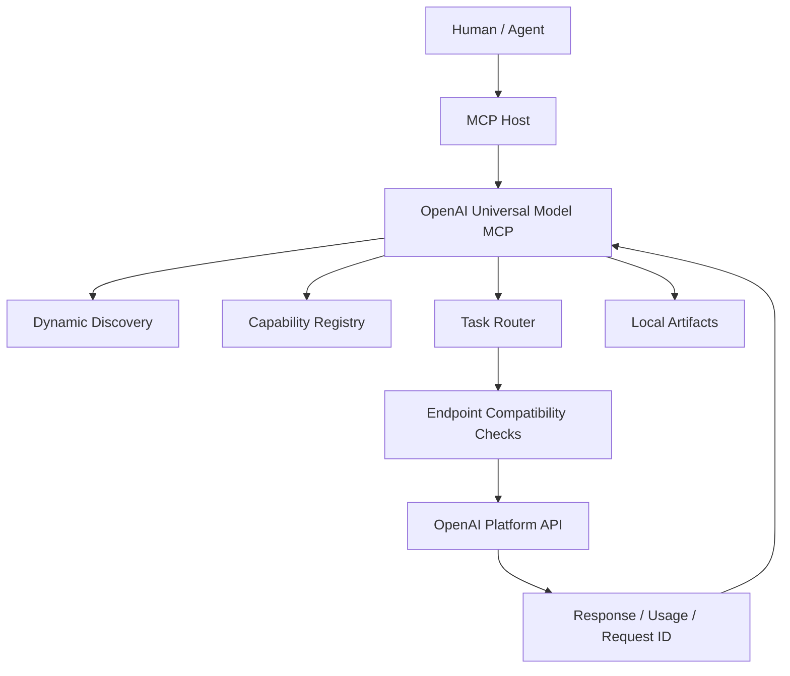

# Architecture

## Runtime flow

## Separation of concerns

- `config.py`: environment and secret loading.
- `api.py`: fixed-host HTTP transport and normalized errors.
- `security.py`: model ID validation, file bounds, output containment, REST allowlist.
- `registry.py`: capability metadata, lifecycle state, deterministic recommendation priorities.
- `server.py`: MCP tool, resource, and prompt registration.
- `config/model_capabilities.json`: human-reviewable catalog metadata snapshot.
- `skills/`: agent operating procedures.

## Discovery and capability model

The live Models API is authoritative for model visibility. The local registry is a supplement, not a replacement. The server returns both the live record and the registry status. For an unknown model, `metadata_status=unknown`; it must not be guessed into a specialized endpoint.

## Endpoint routing

| Workload | Endpoint | MCP tool |
|---|---|---|
| Text/reasoning/vision/tool use | `POST /v1/responses` | `openai_create_response` |
| Chat/audio model workflows | `POST /v1/chat/completions` | `openai_create_chat_completion` |
| Image generation | `POST /v1/images/generations` | `openai_generate_image` |
| Image editing | `POST /v1/images/edits` | `openai_edit_image` |
| Recorded audio transcription | `POST /v1/audio/transcriptions` | `openai_transcribe_audio` |
| Speech generation | `POST /v1/audio/speech` | `openai_generate_speech` |
| Embeddings | `POST /v1/embeddings` | `openai_create_embeddings` |
| Moderation | `POST /v1/moderations` | `openai_moderate_content` |
| Realtime ephemeral auth | `POST /v1/realtime/client_secrets` | `openai_create_realtime_client_secret` |
| GPT-Live WebRTC | `POST /v1/live/sessions` | `openai_create_live_session` |

## Why both Responses and Chat Completions?

Responses is the primary interface for modern text, reasoning, image input, structured output, and tool use. Some specialized audio workflows and legacy-compatible models may require Chat Completions. The adapter exposes both instead of silently rewriting one API's request schema into another.

## Realtime boundary

MCP is a request/response tool protocol. It is appropriate for model discovery, short-lived credential creation, and session setup, but not for carrying a continuous bidirectional audio stream. Realtime clients must own the WebRTC/WebSocket connection and event loop.
